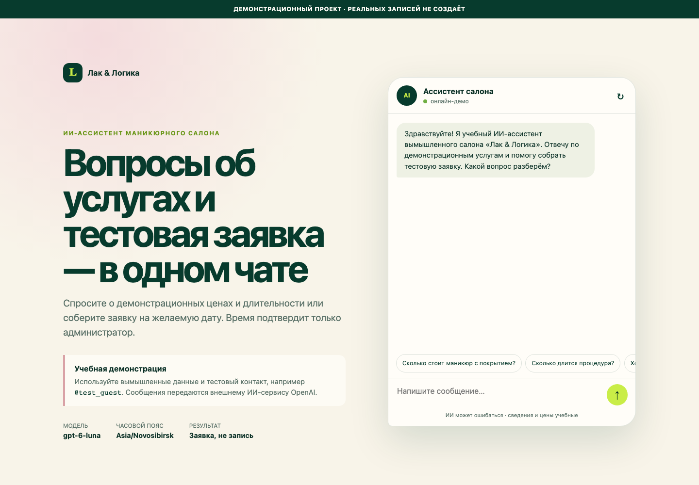
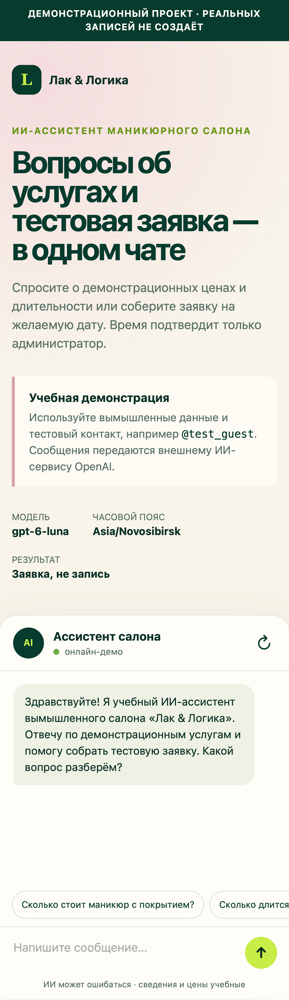

# ИИ-ассистент маникюрного салона

Рабочая учебная демонстрация веб-чата для вымышленного салона «Лак & Логика». Ассистент отвечает только по редактируемой базе знаний, собирает тестовую заявку, показывает её перед отправкой, сохраняет в SQLite и отправляет уведомление в Telegram.

**Демонстрация:** [leads.24tali-ai.ru](https://leads.24tali-ai.ru)  
**Кейс в портфолио:** [24tali-ai.ru/manicure-assistant](https://24tali-ai.ru/manicure-assistant)

> Проект не связан с реальным салоном и не создаёт настоящую запись. Итоговая формулировка: «Заявка принята. Время посещения требует подтверждения администратором».

## Возможности

- русскоязычный веб-чат с реальной моделью OpenAI;
- ответы только по локальной учебной базе услуг и цен;
- сбор услуги, снятия, укрепления, дизайна, даты, имени и контакта;
- поддержка исправлений и относительных дат через ИИ;
- явное подтверждение итогового состава заявки;
- серверная валидация, защита от повторной отправки и изоляция диалогов;
- постоянное хранилище SQLite в WAL-режиме;
- надёжная очередь Telegram с состояниями `pending`, `retry`, `sent`, `failed`;
- закрытая панель заявок `/admin/leads`;
- лимиты длины, частоты, истории и числа выходных токенов;
- адаптивный интерфейс и уведомление о передаче текста внешнему ИИ.

## Схема работы

```text
Браузер → Flask API → серверная машина состояний → OpenAI Responses API
                    ↘ SQLite: диалоги, заявки, очередь уведомлений
                                      ↘ Telegram Bot API
```

ИИ извлекает сведения из свободного текста и формулирует ответ по базе знаний. Решение о готовности заявки, проверка обязательных полей, сохранение и идемпотентность остаются на сервере.

## Технологии

Python 3.12, Flask, SQLite, httpx, OpenAI Responses API, Telegram Bot API, Gunicorn, Docker, Traefik.

## Локальный запуск

```bash
python3 -m venv .venv
source .venv/bin/activate
pip install -r requirements.txt
cp .env.example .env
python app.py
```

Откройте `http://127.0.0.1:8080`. Для проверки тестов установите `pytest` и выполните `pytest -q`.

## Настройки

- услуги, цены, длительность и правила: `knowledge_base.json`;
- модель: `OPENAI_MODEL` (по умолчанию `gpt-6-luna`);
- API OpenAI: `OPENAI_API_KEY`, при необходимости `OPENAI_BASE_URL`;
- Telegram: `TELEGRAM_BOT_TOKEN`, `OPERATOR_CHAT_ID`, `TELEGRAM_TEST_PREFIX`;
- часовой пояс: `SALON_TIMEZONE`;
- защищённая панель: `ADMIN_USERNAME`, `ADMIN_PASSWORD`.

Секреты хранятся только в `.env` или серверном environment-файле и не включаются в образ или Git.

## Размещение

В репозитории есть Dockerfile и compose-конфигурация для существующей сети Traefik. База монтируется в отдельный Docker volume. Контейнер запускается с `restart: unless-stopped`, HTTPS выдаёт Traefik.

## Ограничения

- реального расписания нет: ассистент не проверяет свободное время и не подтверждает запись;
- цены, услуги и салон вымышлены;
- Telegram Bot API не даёт абсолютной exactly-once гарантии при неоднозначном сетевом ответе; очередь снижает риск потери и повторной обработки;
- SQLite подходит для демонстрации и небольшой нагрузки, но не для большого многосерверного кластера;
- ответы ИИ требуют проверки, поэтому бизнес-правила продублированы на сервере.

## Скриншоты и демонстрация

### Десктоп



### Телефон



Обложка кейса создана специально для проекта и лежит в `static/images/originals/manicure-assistant-original.png`; рядом находятся оптимизированные WebP-версии.
